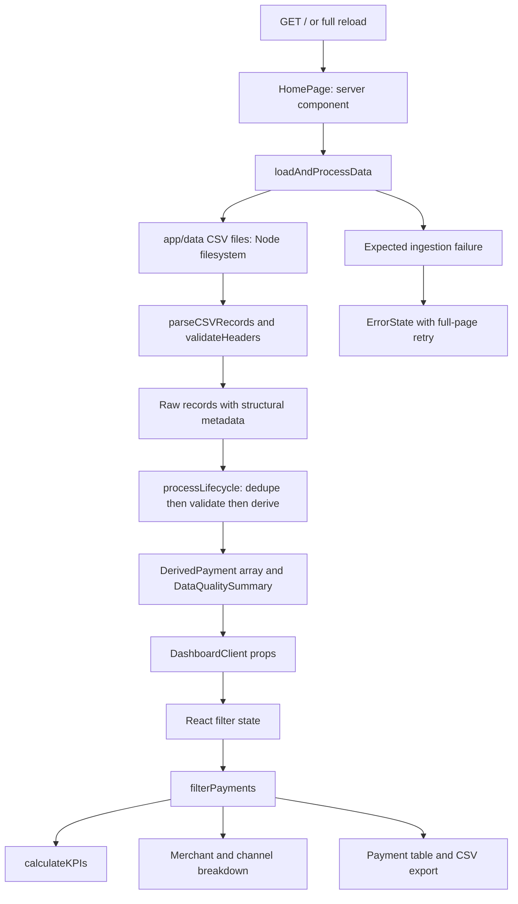

# 1. Architecture and request flow

## What this system does

The consumer is a merchant support analyst. The app reconstructs payment health from exported attempts and events, and lets the analyst inspect a consistent filtered view. It is a read-only snapshot analyzer. It does not initiate captures or refunds, call a payment gateway, persist filters, or subscribe to new events.

The repository has an outer mock directory and an inner Next.js application directory. The outer `package.json` delegates commands with `npm --prefix app`. Next.js routes are under **`app/src/app/`**, while shared business code is under **`app/lib/`**. Confusing these two uses of “app” is an easy source of navigation mistakes.

## Runtime diagram

The successful path does not use a custom REST endpoint, server action, database, or external network service. Next.js still serves its normal page, React payload, JavaScript, and assets; “no custom API” does not mean “no HTTP.”

## Responsibilities and dependency direction

| Layer | Owns | Does not own |
| --- | --- | --- |
| Route (`page.tsx`) | Request entry; dynamic rendering; success/error choice | CSV details, financial math, filter state |
| Ingestion (`loadData.ts`) | Resolve local directory; file reads; schema; raw mapping | UI rendering, refund ordering |
| Parser (`csv.ts`) | Turn text into logical CSV records with diagnostics | Merchant lists, monetary validation |
| Domain (`lifecycle.ts`) | Authoritative revisions, validation, lifecycle, aggregates, formatting/export | Filesystem, React state |
| Types (`types.ts`) | Shapes and allowed domain values | Runtime enforcement by themselves |
| Client (`DashboardClient.tsx`) | Controls, derived UI values, presentation, download | Reading files or writing payment data |

`loadData.ts` imports the parser and domain engine. The client imports domain helpers and types, **not** the filesystem loader. This allows the same pure calculations to run in tests, during ingestion, and for browser filtering. Domain and presentation helpers share one module, which is convenient here but leaves a fairly large file and an import graph worth revisiting if the app grows.

## One page request, step by step

1. Next.js invokes `HomePage`. `export const dynamic = 'force-dynamic'` requests dynamic rendering rather than treating this route as a static snapshot generated once at build time.
2. `loadAndProcessData` resolves a data directory and checks that both files exist. It synchronously reads UTF-8 text.
3. The parser emits logical records. A multiline quoted value is one record, even though it spans physical lines.
4. Headers are checked for expected count and ordered names after trimming. Records become raw attempt/event objects, retaining source line and malformed structure flags.
5. `processLifecycle` selects final revisions, validates them, groups retained candidate events by payment, and derives outcomes and audit arrays.
6. The route returns either `ErrorState` or `DashboardClient`. It passes arrays/plain objects; it does not pass `paymentsMap` from the engine result.
7. Next/React renders the interface and hydrates the client component so its event handlers work. A client component can still contribute to the initial server-rendered HTML; `'use client'` establishes an interactive component boundary, not a promise that initial HTML is absent.
8. Subsequent filter changes run in the browser against the already loaded data. They do not reread CSVs. Full reload/retry triggers another server ingestion.

## Boundary and serialization

Individual amounts are validated safe JavaScript integers. Per-payment refunds cannot exceed that individual capture, so bounded additions/subtractions stay safe. Across payments, sums can exceed `Number.MAX_SAFE_INTEGER`, so aggregate functions use `bigint` internally and return exact base-10 strings. `formatUSD` accepts those strings directly and uses integer division/remainder.

The route currently sends derived payments and audit arrays, not precomputed KPI objects; KPI string fields are mostly calculated in the client. The string-returning aggregate contract remains portable and avoids depending on consumers' BigInt serialization behavior.

## Complexity and scale

Let A be attempt input rows, E event input rows, P valid unique payments, and eᵢ candidate events for payment i. Maps make revision selection and joining approximately O(A + E), with ordinary average constant-time map lookup. Sorting eligible captures and refunds costs up to O(Σ eᵢ log eᵢ); an upper bound is O(E log E). Several per-payment scans remain linear in that payment's events. Overall retained data and audit information require O(A + E) space; raw copies and arrays increase constants.

Each filter change scans P payments and computes three summaries over the filtered result. Fixed four-merchant/three-channel initialization is constant work. There is no pagination or virtualization: rendering all matching rows and shipping all audits become bottlenecks before the algorithm alone does. Synchronous reads and processing also block the Node event loop for their duration. That is an intentional simple local-data design for a small mock, not a high-volume architecture.

## Why these choices fit the brief

A local file design keeps deployment and reasoning simple, pure transformations make adversarial cases testable, and client filtering is instant at 205 valid payments. A database/auth/queue would introduce obligations absent from the brief. For a larger system, propose immutable ingestion snapshots, schema versioning, server queries/pagination, and operational observability as future changes. They are not implemented features.
