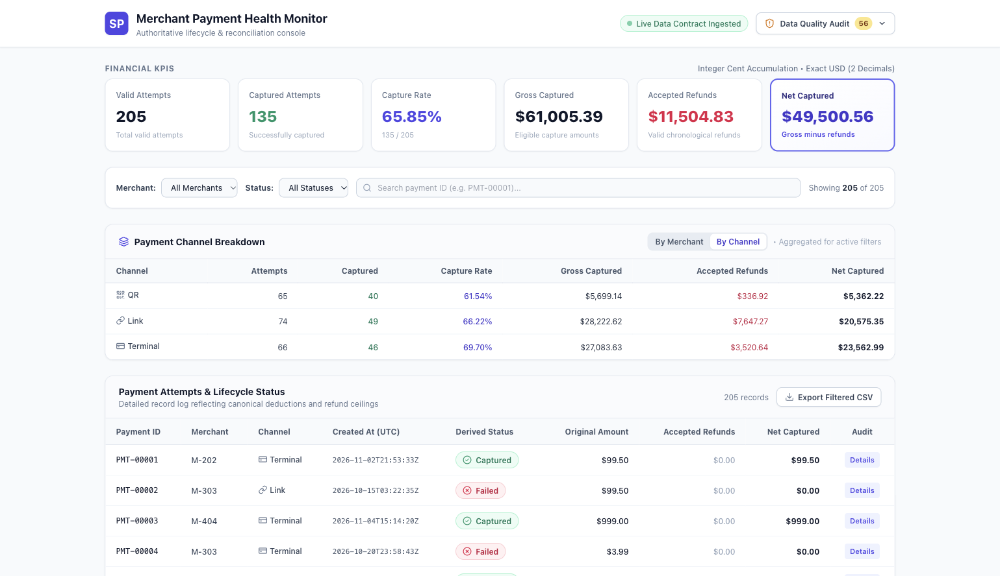
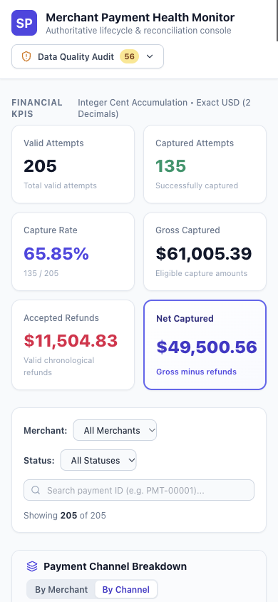

# Executed verification results

Verification ran in the isolated documentation worktree around midnight 7–8 November 2026, Asia/Kolkata. These results apply to this branch and the committed synthetic fixture; they are not a claim of comprehensive production certification.

| Check | Observed outcome |
| --- | --- |
| `npm test` | PASS: 2 files, 12 tests |
| `npm run lint` | PASS: no ESLint warnings/errors |
| `npm run typecheck` (inside app) | PASS: tsc --noEmit exited successfully; command proceeded to server startup |
| `npm run build` | PASS: Next 14.2.15 optimized build; `/` dynamically rendered |
| `python3 data/verify_baseline.py` inside app | PASS: printed matching financial, status, anomaly and merchant totals |
| Comment-only behavior comparison | PASS: TypeScript transpilation with comments removed produced byte-identical JavaScript for all 7 changed TS/TSX files versus base HEAD |
| `git diff --check` | PASS: no whitespace errors |
| Browser: production app | PASS: separate server at 127.0.0.1:3102 |

The comparison used TypeScript `transpileModule` with ES2020/ESNext and React JSX emission, `removeComments: true`, against original and modified source. This establishes that these source edits do not change emitted executable statements, including JSX; it does not replace runtime checks or prove every existing behavior is correct.

## Browser observations

- Initial cards: 205 attempts, 135 captured, 65.85%, $61,005.39 gross, $11,504.83 refunds, $49,500.56 net.
- M-101: 61 attempts, 33 captured, 54.10%, $12,744.46 net.
- M-101 + failed: 17 attempts, zero captured, 0.00%, all money $0.00.
- Adding NONEXISTENT search: no-matches message, 0 records, functional reset.
- Search PMT-00120 and Details: captured, $499.99 gross, $499.99 accepted refunds, $0.00 net; capture EVT-01144 and accepted refunds EVT-01145/EVT-01146 displayed.
- Browser CSV download with PMT-00120 search: header plus exactly one data row; captured, 499.99 amount, 499.99 refunds, 0.00 net. Download read from disk after saving to `/tmp/mock2-filtered-export.csv`.
- Channel switch: selected payment appears under terminal with one attempt/capture, $499.99 gross/refunds and zero net, other categories zero.
- Audit toggle: All 56, Superseded 11, Excluded Final 28, Rejected Events 17; 227/265 input rows, 205/248 valid attempts/candidate events. Counts remained global while payment search active.
- Rendered desktop screenshot inspected at 1540 × 888; mobile emulation inspected at 390 × 844. Mobile top viewport shows wrapped header, two-column cards and stacked controls. Wide tables intentionally scroll horizontally. This was a spot check, not a complete device matrix or assistive-technology test.

## Environment recovery

The initial browser launch failed inside the sandbox. The initial server bind also failed with EPERM. Running the browser and a loopback-only production server with approved sandbox escalation resolved these environment limitations. No application code fix or account/workflow setting change was needed. The first navigation occurred before a server was available and returned connection refused; the successful verification followed startup on loopback.

## Intentionally unverified

Missing/unreadable files and bad-header route UI were inspected in code but not injected through browser file mutations in this run. Loading skeleton visibility, full CSV standards conformance, arbitrary-ID export safety, keyboard/screen-reader accessibility, production hosting, heavy datasets and every mobile panel were not exhaustively tested. Existing limitations are detailed in [chapter 7](07-verification-and-limitations.md). No fixes to those existing behaviors were included in this comments/documentation branch.
